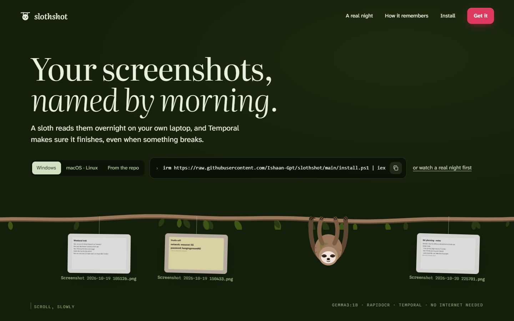
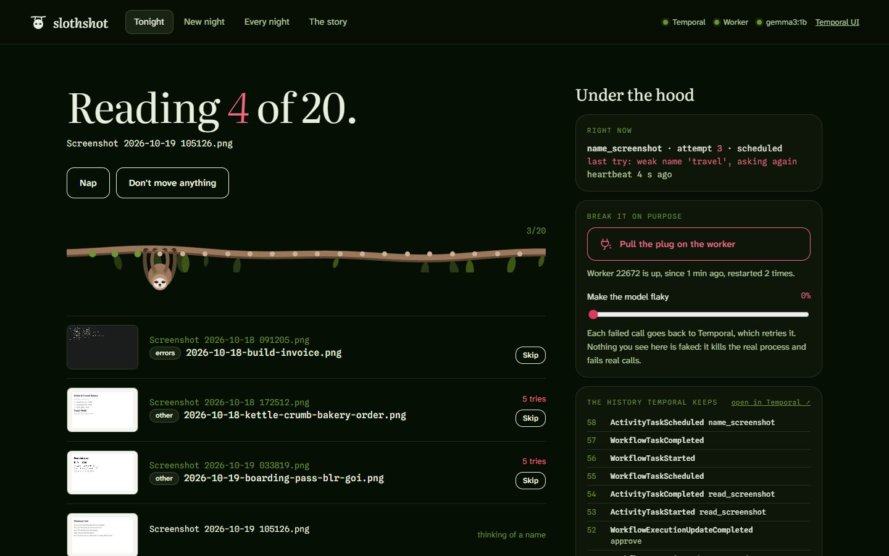
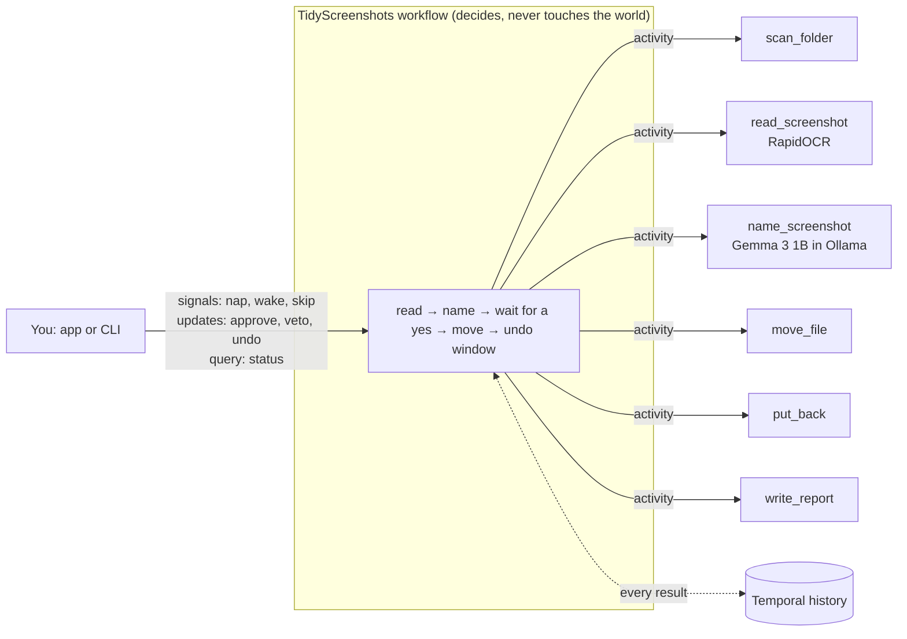

# Slothshot

**Your screenshots, named by morning.** A sloth reads your screenshots folder overnight on your own laptop, names and files every `Screenshot 2026-10-19 105126.png`, and Temporal makes sure it finishes, even when the worker dies halfway through.

- RapidOCR reads the text on each screenshot.
- Gemma 3 1B, running in Ollama, turns that text into a name and a folder.
- A Temporal workflow runs the whole night, so a crash, a closed laptop or a flaky answer costs seconds instead of the whole job.
- Nothing leaves your machine, and it works with no internet at all.

The story page (served by your own copy at `localhost:8765`, and published from this repo to GitHub Pages) replays a real run from its recorded Temporal history: three hard kills, a heartbeat timeout, 66 model calls for 19 names, then approve and undo.





## Install

You need [Ollama](https://ollama.com) (open it once so it is running). The installers bring [uv](https://docs.astral.sh/uv/), and uv brings its own Python 3.12, so there is nothing else to set up.

**Windows** (PowerShell):

```powershell
irm https://raw.githubusercontent.com/kavyasharma200-tech/slothshot/main/install.ps1 | iex
```

**macOS / Linux**:

```bash
curl -fsSL https://raw.githubusercontent.com/kavyasharma200-tech/slothshot/main/install.sh | sh
```

**From a clone** (any OS with uv):

```bash
git clone https://github.com/kavyasharma200-tech/slothshot
cd slothshot
uv run slothshot up
```

On Windows you can also double-click `Start Slothshot.cmd` in the clone.

## Use it

```bash
slothshot up
```

That one command starts everything and opens the app at <http://localhost:8765/app>:

1. a Temporal dev server (it reuses one already running on `localhost:7233`, or downloads and starts its own, keeping its history in `~/.slothshot/temporal.db` so a reboot doesn't forget anything; its UI is on <http://localhost:8233>),
2. a supervised worker, restarted 4 seconds after it dies for any reason,
3. the web server: the story at `/`, the app at `/app`.

In the app, pick your Screenshots folder (or "Try 20 made-up screenshots"), choose when the files may move, and hand it to the sloth. While it works the app is night; once there is a plan it turns to morning. The panel on the right shows what Temporal sees: the activity in flight with its attempt number and last failure, the event history as it grows, and two controls for breaking things on purpose.

Everything also works from the terminal:

| Command | What it does |
|---|---|
| `slothshot up` | Temporal + worker + app, all in one |
| `slothshot doctor` | checks Temporal, Ollama and the model, with a one-line fix for each problem |
| `slothshot pull [model]` | downloads a model through Ollama (default `gemma3:1b`) |
| `slothshot demo [folder]` | draws 20 made-up screenshots to practise on |
| `slothshot tidy FOLDER [--apply-after 8h] [--night 01:30] [--model gemma3:1b]` | starts a night |
| `slothshot status` / `nap` / `wake` / `approve` / `veto` / `undo` / `skip N` | talks to the latest night |
| `slothshot schedule FOLDER --at 01:30` | a Temporal Schedule that tidies the folder every night |
| `slothshot worker` | a worker in the foreground, without the supervisor |

## How Temporal keeps it alive



The workflow only makes decisions; every slow or flaky thing happens in an activity, and Temporal writes each result into the history the moment it finishes. A new worker replays that history instead of redoing the night.

| What goes wrong | What catches it |
|---|---|
| The worker dies, the laptop sleeps, Windows restarts | Finished OCR passes and model answers are in the history; a new worker replays it and carries on at the same screenshot. |
| The worker dies in the middle of a 15-second model call | The call runs in a thread while the activity heartbeats every 3 s; with a 20 s heartbeat timeout the call is retried on the next worker within seconds, not after the 5-minute timeout. |
| Ollama is closed or still loading | The retry policy has no attempt limit and backs off to one try every 30 s, so the sloth waits. |
| The 1B model answers "recipe" or "cart" | At least two words of a name must really be on the screenshot. If not, the activity raises with `next_retry_delay=1s` and asks again a little warmer; after five weak answers it keeps the first words on the screen. |
| A corrupt or deleted image | A non-retryable error: one bad file is marked and skipped, never retried forever. |
| A move fails halfway | A saga: everything already moved is put back, because a half-tidied folder is worse than an untidy one. |
| You change your mind | `approve`, `veto` and `undo` are workflow updates with validators, so a late veto gets "too late, try undo" instead of being ignored. |
| You want it later | `--night 01:30` and the "move after 8 hours unless you say no" wait are durable timers; they survive reboots. |
| Five thousand screenshots | The workflow continues-as-new every 25 screenshots, so no history grows large. |
| Every night, forever | `slothshot schedule` creates a Temporal Schedule. |

Every activity is idempotent: a retried move that finds the file already moved reports the move instead of failing.

## Break it on purpose

- In the app, **Pull the plug on the worker** hard-kills the real worker process. Watch the pending activity's attempt number go up after the heartbeat timeout, while the history shows the new worker carrying on.
- **Make the model flaky** fails a share of real OCR and model calls (it writes `~/.slothshot/chaos`, which the activities read on every call; `SLOTH_CHAOS=0.3` does the same for a worker you start yourself).
- Or quit Ollama in the middle of a night and open it again a minute later.

## Tests

```bash
uv run pytest
```

- `tests/test_replay.py` replays two real recorded histories (`tests/histories/`) against today's workflow code with Temporal's `Replayer`, so a change that would break a night already in flight fails the tests. Run 1 survived three hard kills and an undo; run 2 continued-as-new and was vetoed.
- `tests/test_workflow.py` runs the workflow on Temporal's time-skipping test server with stub activities: the plan applies itself when nobody answers, a veto during reading stops early and moves nothing, undo puts everything back, and the validators refuse what is too early or too late.
- `tests/test_naming.py` covers the name cleaning and the "is it really on the screenshot" check.

## Settings

| Variable | Default |
|---|---|
| `SLOTHSHOT_HOME` | `~/.slothshot` (Temporal db, worker log, last run, chaos file, sample screenshots) |
| `SLOTH_MODEL` | `gemma3:1b`; any Ollama model with structured output works, and the app lets you pick one per night |
| `OLLAMA_URL` | `http://localhost:11434` |
| `SLOTH_CHAOS` | `0` |

## Safety

- The server listens on 127.0.0.1 only, and it serves screenshots only from inside the folder of the night being shown.
- Writes (start a night, approve, veto, undo, pull the plug) need a custom header and a localhost origin, so another website open in your browser can't start a night on your folder or kill your worker.
- Nothing moves until you approve or the wait you chose runs out, a failed move puts everything back, and `undo` works for a day.
- `slothshot demo` only ever wipes a folder it made itself (it leaves a `.slothshot-demo` mark).

## Honest notes

- On an AMD Ryzen 5 7520U with no graphics card, OCR takes 1–6 s and each model answer 3–16 s. The recorded run took about ten and a half minutes for 20 screenshots, including three worker kills.
- Gemma 3 1B is small, and you can see it: it needed 66 calls for 19 names, and 7 screenshots fell back to their first words. Its folders are sometimes wrong (the boarding pass went to `other`). `qwen2.5:1.5b` answered about twice as fast in a side-by-side and chose better folders, but sometimes copied the example name from the prompt, which the grounding check rejects.
- OCR can't read a picture with no words in it, so those files are left alone rather than guessed. An open vision model in Ollama would be the next activity to add, and the workflow wouldn't change.

## Project layout

```
src/slothshot/
  workflows.py    the durable night: decides, waits, moves, undoes
  activities.py   scanning, OCR, the model call, moves, put-backs, the report
  worker.py       one activity at a time, so the laptop stays usable
  cli.py          slothshot up / doctor / tidy / schedule / ...
  server.py       FastAPI: the story, the app and the JSON API
  demo.py         draws 20 made-up screenshots with Pillow
  web/            index.html (the story), app.html (the app), assets/
scripts/export_night.py   turns a recorded history into the story page's replay data
tests/                    replay tests on real histories, time-skipping workflow tests
install.ps1, install.sh   one-line installers
```

## Credits

Gemma 3 (Google, open weights), RapidOCR and PaddleOCR models (Apache 2.0), Ollama (MIT), Temporal (MIT), FastAPI (MIT), GSAP (free licence), Lenis (MIT). Fonts: Literata, Atkinson Hyperlegible Next and Spline Sans Mono (SIL Open Font License). Slothshot itself is MIT.

Made for the DEV Hacktoberfest Open-Source AI Challenge, week 3: Slow and Steady.
